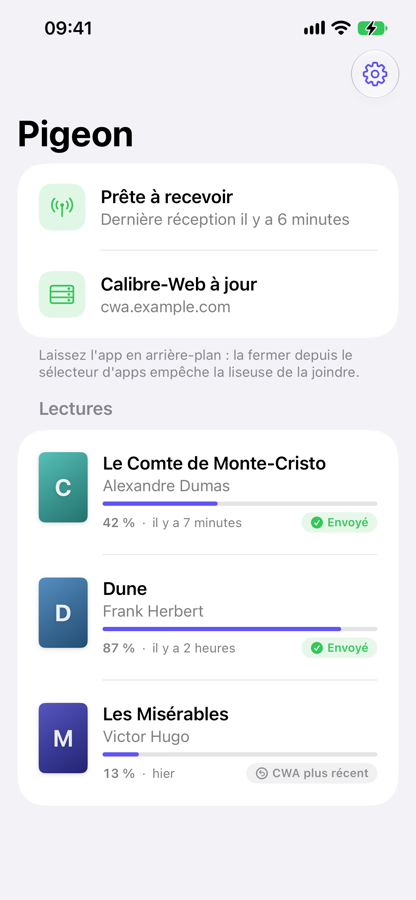
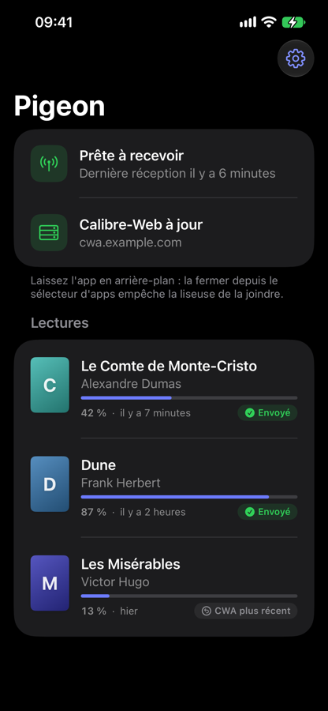
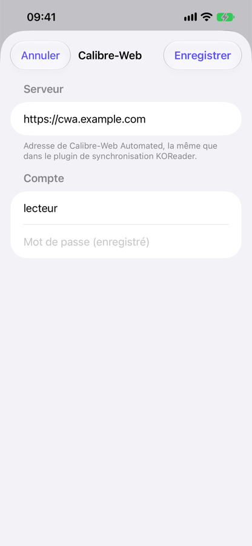

# calibre-sync

Syncs KOReader reading progress from a PocketBook to [Calibre-Web Automated](https://github.com/crocodilestick/Calibre-Web-Automated) (CWA) **without Wi-Fi on the e-reader**: the progress goes over Bluetooth Low Energy to an iPhone app, which pushes it to CWA whenever it has Internet.

**About 30 times less battery than leaving Wi-Fi on to sync**: Wi-Fi left on adds 19 % to the e-reader's draw while reading; BLE sync adds under 1 % ([measured](docs/battery.md)).

<p align="center">
  
  
  
</p>

```text
PocketBook (KOReader)              iPhone (Pigeon app)               Server
pigeon.koplugin                    GATT service                      CWA
  queues progress    ── BLE ──▶      stores progress     ── HTTPS ──▶  /kosync
  scans, connects, writes            GET, then PUT if newer
```

The e-reader is the BLE central because its kernel cannot advertise (see [docs/hardware.md](docs/hardware.md)). The iPhone app exposes the service and keeps it alive in the background.

## Why Bluetooth rather than Wi-Fi

`cwasync` already syncs to CWA over Wi-Fi, but only while the e-reader has Wi-Fi: either left on while reading, or turned on by hand (and an iPhone hotspot enabled by hand when away from home). This project removes both:

- **Battery.** Measured on a PocketBook Verse Pro, then scaled to an hour of reading at one page a minute:

  | | Extra draw | Per hour of reading |
  |---|---|---|
  | Wi-Fi left on (`cwasync`) | +16 mA, all the time | ≈ 16 mAh, +19 % |
  | BLE sync, every 20 pages | +19 mA for 30 s per sync | ≈ 0.5 mAh, under +1 % |

  No radio stays on: Bluetooth is switched on for about 30 s per sync, then fully off (`netagent bt off` stops the chip), and Wi-Fi stays off. Figures are orders of magnitude from one run; method in [docs/battery.md](docs/battery.md).
- **Works anywhere the iPhone is.** The phone brings the Internet connection; no hotspot to enable.
- **Offline-safe.** Progress waits on the e-reader until the iPhone acknowledges it, then on the iPhone until CWA is reachable.

## Install

Download both files from the [latest release](../../releases/latest).

**KOReader plugin.** Unzip `pigeon.koplugin.zip` into `koreader/plugins/` on the e-reader, then restart KOReader.

**iOS app.** `Pigeon-unsigned.ipa` is unsigned: install it with [AltStore](https://altstore.io) or Sideloadly, which sign it with your Apple account. With a free account the signature lasts 7 days; AltStore renews it automatically. You can also build from Xcode (`ios/Pigeon.xcodeproj`).

Open the app once, tap the gear and enter your CWA URL, username and password. The password stays in the iOS Keychain and never goes over Bluetooth.

## Use

Read as usual. The plugin syncs:

- every N pages (default 20, set in **Pigeon › Sync every N pages**, 0 to disable);
- when you close a book and when the e-reader wakes up;
- on demand with **Pigeon › Sync now**, or a gesture bound to **Pigeon: sync now**.

A sync takes about 30 s. Manual syncs show *Synchronisé à HH:MM*; any sync that cannot reach the iPhone shows *iPhone introuvable* and keeps the progress for the next attempt.

**Leave the app in the background.** iOS relaunches it when the e-reader writes, even after it has been suspended, but never after a force-quit from the app switcher.

## How it stays correct

- **Same book identity as CWA.** The plugin sends KOReader's `partial_md5_checksum`, `progress` and `percentage`, computed like CWA's own `cwasync.koplugin`.
- **Late relays never overwrite newer reads.** CWA timestamps progress on receipt, so the app first `GET`s the server's progress and only `PUT`s if its own is newer.
- **Read time survives a wrong e-reader clock.** The app dates each read as `received_at − (sent_at − captured_at)`, using only the gap between the two e-reader timestamps.
- **Nothing is lost.** The plugin keeps the latest progress per book until the app acknowledges the write.

## BLE contract

| | |
|---|---|
| Service | `947694FE-0425-4E30-84BC-FB783E781EAD` |
| `progress` characteristic | `1FD42B59-27A4-49F9-B36B-C1D0F9C445B2`, write with response, unencrypted |

One JSON object per write (long write, kept under 512 bytes):

```json
{"v":1,"document":"9e107d9d…","progress":"/body/DocFragment[12]/…","percentage":0.4567,
 "device":"PocketBook Verse Pro","device_id":"…","title":"Dune","author":"Frank Herbert",
 "captured_at":1794680000,"sent_at":1794680582}
```

No encryption: the kernel cannot resolve the iPhone's rotating address, so a bond would never be reused, and reading positions are not sensitive.

## Development

| Path | What |
|---|---|
| `pigeon.koplugin/` | KOReader plugin (`main.lua`) and the BLE sender it runs in the background (`pigeon.sh`, `gatttool`) |
| `ios/` | SwiftUI app; `ios/cwa-check/run.sh` checks the CWA upload logic against a fake server |
| `poc/` | Shell test from the hardware exploration |
| `docs/hardware.md` | What the PocketBook can and cannot do over Bluetooth |
| `tools/power-test.sh` | Battery test behind `docs/battery.md` |

CI builds the plugin zip and an unsigned IPA on every push. Pushing a `v*` tag publishes both as a release.

A weekly job compares the CWA files this project mirrors (`cwasync.koplugin`, `progress_syncing`) with the versions pinned in `.github/upstream.lock`, and opens an issue when they change. After checking compatibility, pin the new versions with `.github/scripts/upstream-check.sh --update`.

## Known limits

- Force-quitting the iOS app stops syncing until it is reopened (iOS rule).
- In a place with many Apple devices, the iPhone may fall outside the 5 candidates the e-reader tries.
- Progress only flows from the e-reader to CWA; pulling progress read elsewhere is not implemented.
